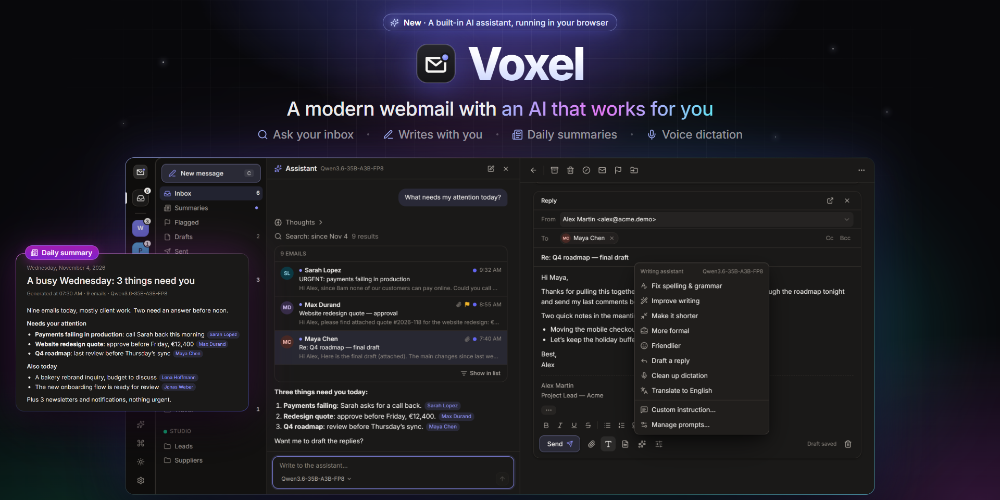

A modern webmail: fast, installable, works offline, and handles several mailboxes at once.

It talks to JMAP servers such as [Stalwart](https://stalw.art) straight from the browser, and to any IMAP/SMTP mailbox through a small gateway.

Its built-in AI assistant searches your mail, helps you write and sends you a daily summary. It runs in the browser with your own provider (any OpenAI-compatible API such as Ollama or vLLM, or Anthropic); keys stay encrypted on your device.

## Run

```sh
cp config.example.json config.json   # map your mail domains to their JMAP server
VOXEL_HOST=webmail.example.com docker compose up -d --build
```

The JMAP server must allow the webmail's origin (CORS).

Installed as an app, the webmail shows the number of unread conversations on its icon. Once notifications are on, mailboxes whose JMAP server offers Web Push are also notified while the app is closed, and each new message adds one to the icon.

### Large attachments

With an S3 bucket, an attachment over 1 MB is not put in the message: it goes to S3 and the message carries a download link, valid for 30 days. Each sender gets 1 GB of space. Voxel creates the sender's account the first time they attach a large file and only tells them so. The webmail server checks the sender with their mail server, which must be one of the servers of `config.json`; IMAP mailboxes and the desktop app attach files as before. The S3 engine is the one of [S3 Drive](https://github.com/djdevpro/s3drive), in `apps/server/src/vendor/ud-s3`.

| Variable | Default | |
|---|---|---|
| `VOXEL_S3_BUCKET` | | Turns the feature on |
| `VOXEL_S3_ENDPOINT` | | `https://…`, for example `https://nbg1.your-objectstorage.com` |
| `VOXEL_S3_ACCESS_KEY_ID`, `VOXEL_S3_SECRET_ACCESS_KEY` | | Keys of the bucket |
| `VOXEL_S3_REGION`, `VOXEL_S3_ADDRESSING` | from the endpoint | `path` or `virtual` |
| `VOXEL_S3_PREFIX` | `voxel/` | Folder of the files in the bucket |
| `VOXEL_S3_THRESHOLD_BYTES` | `1048576` (1 MB) | Size over which a file goes by link |
| `VOXEL_S3_QUOTA_BYTES` | `1073741824` (1 GB) | Space of each sender |
| `VOXEL_S3_LINK_DAYS` | `30` | Life of a link; the file is then deleted |
| `VOXEL_S3_ALLOW_PRIVATE` | | `1` for an endpoint on a private network, such as MinIO next to Voxel |

To check the sender, the webmail sends the server the mailbox's `Authorization` header, the one it sends the JMAP server, and the server shows it to that JMAP server once. It keeps no password, only a hash of the header for 10 minutes. Browsers send the files straight to S3, so the bucket's CORS rule should allow `PUT` from the webmail's origin. Without it, files go through the webmail server, and your proxy must then accept long uploads. The server keeps its list of accounts and files in `files.sqlite`, in its data folder.

## Develop

Node 24 or later.

```sh
npm install
npm run dev:web    # http://localhost:5273
npm run dev:demo   # demo mailboxes and a simulated AI, no server needed: sign in as alex@acme.demo / demo
npm test
```

## Desktop

Voxel also runs as a desktop app for Windows and Linux, built with Tauri 2 and Rust. It shows the same interface as the webmail, with the same themes, languages and AI assistant, and it works with any JMAP server, without CORS, and with any IMAP/SMTP mailbox.

### Run it

You need Rust, the Microsoft C++ build tools, and WebView2, which Windows 10 and 11 already include. From the repository root:

```sh
npm install
npm run dev:desktop
```

The development app loads the interface from its own Vite server on port 5373, so it can run next to `npm run dev:web` on port 5273. Only one Voxel runs at a time, so close the installed app before starting the development one. `npm run build:desktop` builds the installer in `apps/desktop/target/release/bundle/nsis`. The installer is not signed yet, so Windows may say its publisher is unknown: choose More info, then Run anyway. `npm run test:desktop` runs the Rust tests, and `npm -w @voxel/desktop run licenses` lists the licenses of every Rust dependency.

On Linux, make the `.AppImage` executable and open it, or install the `.deb` or `.rpm` package. Linux needs WebKitGTK 4.1 (Ubuntu 22.04, Debian 12, Fedora 38 or later) and a Secret Service, such as GNOME Keyring or KWallet, to keep the device key. To build on Linux, install these packages first, then run `npm run build:desktop`, which builds the `.deb`, `.rpm` and `.AppImage` in `apps/desktop/target/release/bundle`:

```sh
sudo apt-get install -y libwebkit2gtk-4.1-dev libayatana-appindicator3-dev librsvg2-dev patchelf libssl-dev rpm
```

`npm run release:desktop` starts the release workflow on GitHub, with `gh` signed in. It builds the Windows installer and the Linux packages and publishes them as the `desktop-v<version>` release, with the version from `apps/desktop/src-tauri/tauri.conf.json`. It never replaces a published release, so raise the version before you release again.

### Updates

The installed app updates itself. At startup and every 6 hours, it reads `latest.json` from the latest GitHub release. When a newer version is out, it offers to install it and restart. It installs only files signed with the Voxel update key, whose public half is in `apps/desktop/src-tauri/tauri.conf.json`. On Linux, the AppImage, `.deb` and `.rpm` each update with their own package. Development builds never look for updates. Versions before 0.2.0 have no updater, so install the next version once by hand.

`npm run release:desktop` signs the installer and the packages in a job of their own, never while npm and Cargo build, checks each signature against that public key, then publishes `latest.json` with the release. It needs two repository secrets, the private key and its password:

```sh
npx tauri signer generate -w ~/.tauri/voxel-updater.key   # once; keep the key and its password safe
gh secret set TAURI_SIGNING_PRIVATE_KEY --repo djdevpro/voxel < ~/.tauri/voxel-updater.key
gh secret set TAURI_SIGNING_PRIVATE_KEY_PASSWORD --repo djdevpro/voxel   # paste the password
```

Without the private key, no installed app can be updated anymore: a new key means a manual reinstall for everyone.

### How it works

- The server part of Voxel runs inside the app, in Rust, in the same process as the window. It contains the IMAP/SMTP gateway, ManageSieve, CardDAV, CalDAV, server discovery, network rules, limits and local storage. Node is not needed at runtime.
- The app opens no network port. The interface calls the Rust core through Tauri commands, which only the app's own view may use. A web page or another program cannot reach it. The HTML of an email stays in a sandboxed frame where no script can run, so it cannot call the app's commands.
- Every network request of the interface goes through the core. The core talks to JMAP servers directly, so they do not need to allow CORS. Push events, downloads and AI streams flow back to the interface as they arrive.
- The key that encrypts saved passwords, API tokens and AI keys stays in the Windows Credential Manager. On disk, the app keeps only encrypted secrets, in its data folder under `%LOCALAPPDATA%\dev.voxel.desktop`.
- Closing the window keeps Voxel running in the notification area, so new mail still shows a native notification and the number of unread conversations appears on the taskbar button and on the notification area icon. Quit Voxel from the menu of that icon. Voxel also starts in the background when you sign in to your computer. Both can be turned off in Settings, Reading & sending. On Windows, clicking a notification closes it but does not open the message yet.
- Links open in your default browser, and files are saved through a Save as dialog. A second launch brings the open window to the front.
- The desktop app can reach servers on your local network. It uses plain `http://` only for this computer and TLS everywhere else.

### Self-test

`VOXEL_DESKTOP_SELFTEST=<folder> npm run dev:desktop -- --no-watch` signs in to the test mailbox of `.env.test.local`. It sends itself a message with an attachment, waits for it without reloading, reads it, saves the attachment to disk, then searches, flags, moves and deletes it. It also checks that a trapped HTML email cannot reach the app. It saves a PNG of each screen and a `report.txt` in that folder, then quits. Run it again with `VOXEL_DESKTOP_SELFTEST_PHASE=resume` to check that the mailbox and settings survived the restart, and to clean up. To test another server, set `VOXEL_SELFTEST_SESSION_URL`, `VOXEL_SELFTEST_USER` and `VOXEL_SELFTEST_PASSWORD`. Use a short folder, such as `C:\t\voxel-selftest\main`: WebView2 cannot open its storage under a long path. The report also lists the features the interface shows for that server, and checks that the app process listens on no port.

To run the self-test on the production build of the interface, with its Content Security Policy, the `http://tauri.localhost` origin and no service worker, run `npm run build:desktop:debug`, then start `apps/desktop/target/debug/voxel-desktop.exe` with the same variables. The self-test exists only in debug builds: the released app does not contain it and ignores these variables.

### JMAP compatibility

`npm run compat:jmap` starts several JMAP servers in Docker, in the `voxel-compat` compose project on its own ports. It plays the same scenario on each of them and on the test mailbox, then stops them.

## License

[MIT](LICENSE)
